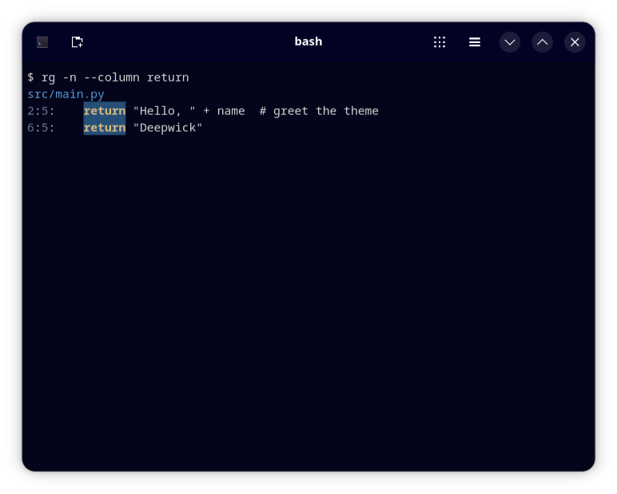

# Deepwick for ripgrep

Deepwick colors for [ripgrep](https://github.com/BurntSushi/ripgrep).

> Deepwick is an unofficial theme derived from
> [Polywick Blue](https://vscode.polywickstudio.net) by Polywick Studio (MIT).
> Not affiliated with Polywick Studio.



## Install

```sh
mkdir -p ~/.config/ripgrep
cp deepwick.ripgreprc ~/.config/ripgrep/
```

Then set `RIPGREP_CONFIG_PATH`. In bash or zsh, add the line from
`deepwick.sh` to your rc file; in fish, the line from `deepwick.fish`.

If you already have a ripgrep config file, copy the `--colors` lines into it
instead. ripgrep reads only one config file.

## Notes

- Colors need a terminal with 24-bit color.
- File paths Blue, line and column numbers Muted, matches bold Gold on
  Selection (the Deepwick current-search-match colors).

Tested with ripgrep 15.1.0.

## License

MIT. See [LICENSE](LICENSE).
